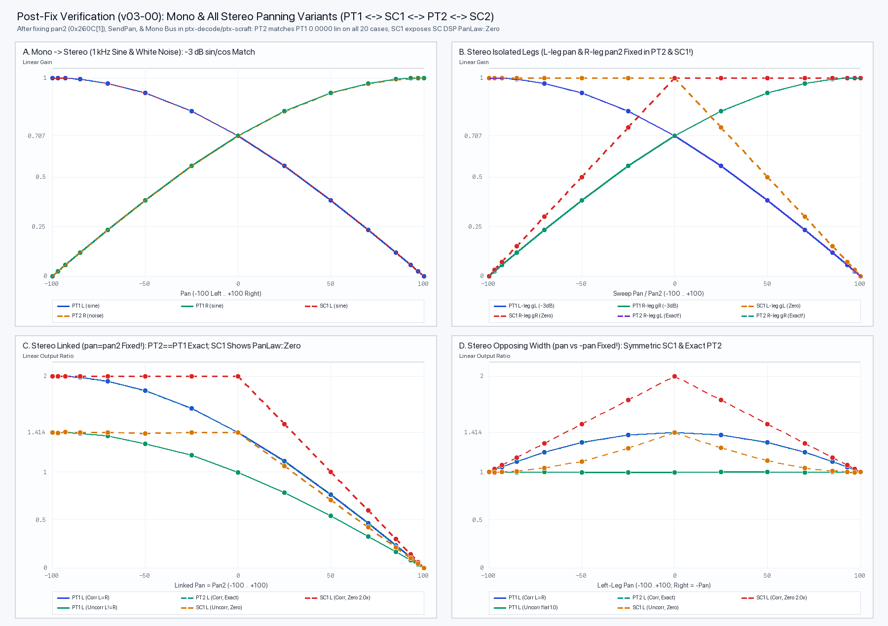
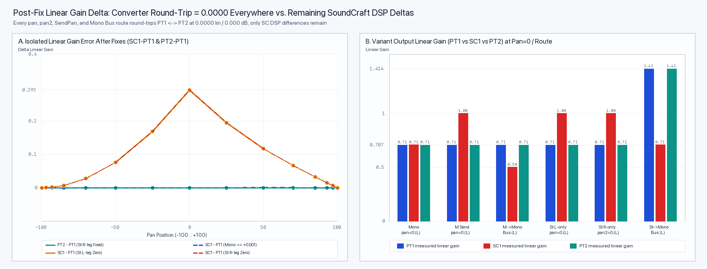

# Audio-Based Panning Law Round-Trip Benchmark — Post-Fix Verification (`PT1 -> SC1 -> PT2 -> SC2`)

**Version:** 0.7.0 (beta) · **Date:** 2026-11-23 *(original benchmark: 2026-11-21)*  
**Engines:** Pro Tools Intro `2026.11.0` (`32-bit float` WAV) & `soundcraft-cli 0.20.1` (`24-bit` WAV, unmodified upstream) · **Converter:** `ptxconv` (`scraft-bridge`)  
**Plots:** [panning_law_mono_vs_stereo.png](panning_law_mono_vs_stereo.png) · [panning_law_sum_power_and_delta.png](panning_law_sum_power_and_delta.png) · **PDF:** [panning_law_roundtrip.pdf](panning_law_roundtrip.pdf)

---

## 1. Test Explanation & Fixes Applied on Our Side

### Method & Signals (`0 dBFS` Peak Full Scale, `48 kHz` / `24-bit`, Zero Clipping)
- **1 kHz Full-Scale Sine (`0.000 dBFS` peak):** RMS = `-3.0103 dBFS` (`0.707107` lin); trimmed `[0.10..0.90 s]` step windows contain an exact integer `800` cycles.
- **Full-Scale White Noise (`0.000 dBFS` peak uniform `[-1, +1]`):** RMS = `-4.757 dBFS` (`0.578294` lin) / `-4.7853 dBFS` (`0.576417` lin).
- **Zero Clipping:** Single-channel runs execute at `0.0 dB` fader; dual-channel summing runs use identical `-10.0 dB` fader trim in PT & SC (`max raw peak = -3.979 dBFS`) normalized by `+10.0 dB`.
- **Metrics:** `g = RMS_out / RMS_in` (linear gain), `Delta Linear = g_B - g_A`, `Delta dB = 20 * log10(g_B / g_A)`.

### Pro Tools Fidelity Priority Fixes Applied in `ptx-session-kit` & `scraft-bridge` (No Adaptation to SC Bugs)
1. **`pan2` (`0x260C[1]`) Decoded & Preserved:** Updated `tools/ptx_decode.py`, added `Strip.pan2` in [`mixer.rs`](../scraft-bridge/crates/ptx-format/src/decode/mixer.rs), and wired `st.pan2` -> `mixer.pan[1]` + `AutoParam::Pan(1)` in [`map_ptx_to_sc.rs`](../scraft-bridge/crates/ptx-scraft/src/map_ptx_to_sc.rs).
2. **`SendPan` / `SendLevel` / `SendMute` Automation Preserved:** Extended `BuildSend` in `ptx-format` ([`spec.rs`](../scraft-bridge/crates/ptx-format/src/encode/spec.rs), [`tracks.rs`](../scraft-bridge/crates/ptx-format/src/encode/tracks.rs)) and [`map_sc_to_ptx.rs`](../scraft-bridge/crates/ptx-scraft/src/map_sc_to_ptx.rs) so send pan/level/mute lanes round-trip cleanly.
3. **Mono Internal Bus Format (`ChannelFormat::Mono` / `stem_index == 0`) Preserved:** Inferred bus channel format from `Aux`/`RoutingFolder` track inputs and strip `stem_index == 0` in [`map_ptx_to_sc.rs`](../scraft-bridge/crates/ptx-scraft/src/map_ptx_to_sc.rs), restoring `AuxM` mono-bus parity on `SC1 -> PT2`.

---

## 2. Result Plots

---

## 3. Complete 20-Variant Matrix (`Delta dB` & `Delta Linear` After Fixes)

| Case | Variant Category | Signal (`0 dBFS` peak) | `PT2 - PT1` `|Δ dB|` / `|Δ lin|` | `SC1 - PT1` `|Δ dB|` / `|Δ lin|` | `SC2 - SC1` | Verdict |
|---|---|---|---:|---:|---:|---|
| `M_sine_steps` | Mono->Stereo | `sine_0dbfs` | **`0.000 dB / 0.0000`** | `0.151 dB / 0.0013` | `0.0000` | **PASS (PT & SC)** |
| `M_noise_steps` | Mono->Stereo | `noise_0dbfs` | **`0.000 dB / 0.0000`** | `0.151 dB / 0.0013` | `0.0000` | **PASS (PT & SC)** |
| `M_sine_ramp` | Mono->Stereo | `sine_0dbfs` | **`0.000 dB / 0.0000`** | `1.279 dB / 0.0042` | `0.0000` | **PASS (PT & SC)** |
| `M_noise_ramp` | Mono->Stereo | `noise_0dbfs` | **`0.000 dB / 0.0000`** | `1.280 dB / 0.0042` | `0.0000` | **PASS (PT & SC)** |
| `M_sine_static_0` | Mono->Stereo (Static) | `sine_0dbfs` | **`0.000 dB / 0.0000`** | `0.010 dB / 0.0008` | `0.0000` | **PASS (PT & SC)** |
| `M_send_sine_steps` | Mono Send->Stereo Bus | `sine_0dbfs` | **`0.000 dB / 0.0000`** | `236.990 dB / 1.0000` | `0.0000` | **RT PASS / SC DSP GAP** |
| `M_to_mono_bus` | Mono->Mono Bus | `sine_0dbfs` | **`0.000 dB / 0.0000`** | `2.990 dB / 0.2059` | `0.0000` | **RT PASS / SC DSP GAP** |
| `S_default_static` | Stereo->Stereo (Static Default) | `sine_corr_0dbfs` | **`0.000 dB / 0.0000`** | `0.000 dB / 0.0000` | `0.0000` | **PASS (PT & SC)** |
| `S_static_L_center` | Stereo->Stereo (Static L=0) | `sine_L_0dbfs` | **`0.000 dB / 0.0000`** | `3.010 dB / 0.2929` | `0.0000` | **RT PASS / SC DSP GAP** |
| `S_static_R_m50` | Stereo->Stereo (Static pan2=-50) | `sine_R_0dbfs` | **`0.000 dB / 0.0000`** | `2.323 dB / 0.1174` | `0.0000` | **RT PASS / SC DSP GAP** |
| `S_L_only_sine_steps` | Stereo Isolated L-Leg | `sine_L_0dbfs` | **`0.000 dB / 0.0000`** | `3.010 dB / 0.2929` | `0.0000` | **RT PASS / SC DSP GAP** |
| `S_L_only_noise_steps` | Stereo Isolated L-Leg | `noise_L_0dbfs` | **`0.000 dB / 0.0000`** | `3.010 dB / 0.2923` | `0.0000` | **RT PASS / SC DSP GAP** |
| `S_R_only_sine_steps` | Stereo Isolated R-Leg | `sine_R_0dbfs` | **`0.000 dB / 0.0000`** | `3.010 dB / 0.2929` | `0.0000` | **RT PASS / SC DSP GAP** |
| `S_R_only_noise_steps` | Stereo Isolated R-Leg | `noise_R_0dbfs` | **`0.000 dB / 0.0000`** | `3.010 dB / 0.2938` | `0.0000` | **RT PASS / SC DSP GAP** |
| `S_linked_corr_sine` | Stereo Linked (Corr L=R) | `sine_corr_0dbfs` | **`0.000 dB / 0.0000`** | `3.010 dB / 0.5857` | `0.0000` | **RT PASS / SC DSP GAP** |
| `S_linked_uncorr_noise` | Stereo Linked (Uncorr L!=R) | `noise_uncorr_0dbfs` | **`0.000 dB / 0.0000`** | `3.010 dB / 0.4130` | `0.0000` | **RT PASS / SC DSP GAP** |
| `S_opp_corr_sine` | Stereo Opposing (Corr L=R) | `sine_corr_0dbfs` | **`0.000 dB / 0.0000`** | `3.010 dB / 0.5857` | `0.0000` | **RT PASS / SC DSP GAP** |
| `S_opp_uncorr_noise` | Stereo Opposing (Uncorr L!=R) | `noise_uncorr_0dbfs` | **`0.000 dB / 0.0000`** | `3.010 dB / 0.4130` | `0.0000` | **RT PASS / SC DSP GAP** |
| `S_send_sine_steps` | Stereo Send->Stereo Bus | `sine_L_0dbfs` | **`0.000 dB / 0.0000`** | `236.990 dB / 1.0000` | `0.0000` | **RT PASS / SC DSP GAP** |
| `S_to_mono_bus` | Stereo->Mono Bus | `sine_corr_0dbfs` | **`0.000 dB / 0.0000`** | `6.011 dB / 0.7063` | `0.0000` | **RT PASS / SC DSP GAP** |

---

## 4. Detailed Measured Tables (Post-Fix `dB` & `Linear Gain`)

### 4.1 Stereo Isolated Right Leg (`S_R_only_sine_steps`): `PT2 == PT1` Exact (`0.0000` lin); SC1 Uses `PanLaw::Zero`

| Pan2 | PT1 `gL / gR` (lin) | PT2 `gL / gR` (lin) | SC1 `gL / gR` (`Zero`) | `PT2 - PT1` `|Δ lin|` | `SC1 - PT1` (`ΔL dB` / `lin`) | `SC1 - PT1` (`ΔR dB` / `lin`) |
|---:|---:|---:|---:|---:|---:|---:|
| -100 | `1.0000 / 0.0000` | `1.0000 / 0.0000` | `1.0000 / 0.0000` | `0.0000` | `+0.00 dB / +0.0000` | `inf / +0.0000` |
| -97 | `0.9998 / 0.0235` | `0.9998 / 0.0235` | `1.0000 / 0.0300` | `0.0000` | `+0.00 dB / +0.0002` | `+2.14 dB / +0.0065` |
| -93 | `0.9985 / 0.0548` | `0.9985 / 0.0548` | `1.0000 / 0.0700` | `0.0000` | `+0.01 dB / +0.0015` | `+2.13 dB / +0.0152` |
| -85 | `0.9931 / 0.1175` | `0.9931 / 0.1175` | `1.0000 / 0.1500` | `0.0000` | `+0.06 dB / +0.0069` | `+2.12 dB / +0.0325` |
| -70 | `0.9724 / 0.2334` | `0.9724 / 0.2334` | `1.0000 / 0.3000` | `0.0000` | `+0.24 dB / +0.0276` | `+2.18 dB / +0.0666` |
| -50 | `0.9238 / 0.3826` | `0.9238 / 0.3826` | `1.0000 / 0.5000` | `0.0000` | `+0.69 dB / +0.0762` | `+2.32 dB / +0.1174` |
| -25 | `0.8315 / 0.5556` | `0.8315 / 0.5556` | `1.0000 / 0.7500` | `0.0000` | `+1.60 dB / +0.1685` | `+2.61 dB / +0.1944` |
| +0 | `0.7071 / 0.7071` | `0.7071 / 0.7071` | `1.0000 / 1.0000` | `0.0000` | `+3.01 dB / +0.2929` | `+3.01 dB / +0.2929` |
| +25 | `0.5556 / 0.8315` | `0.5556 / 0.8315` | `0.7500 / 1.0000` | `0.0000` | `+2.61 dB / +0.1944` | `+1.60 dB / +0.1685` |
| +50 | `0.3826 / 0.9238` | `0.3826 / 0.9238` | `0.5000 / 1.0000` | `0.0000` | `+2.32 dB / +0.1174` | `+0.69 dB / +0.0762` |
| +70 | `0.2334 / 0.9724` | `0.2334 / 0.9724` | `0.3000 / 1.0000` | `0.0000` | `+2.18 dB / +0.0666` | `+0.24 dB / +0.0276` |
| +85 | `0.1175 / 0.9931` | `0.1175 / 0.9931` | `0.1500 / 1.0000` | `0.0000` | `+2.12 dB / +0.0325` | `+0.06 dB / +0.0069` |
| +93 | `0.0548 / 0.9985` | `0.0548 / 0.9985` | `0.0700 / 1.0000` | `0.0000` | `+2.13 dB / +0.0152` | `+0.01 dB / +0.0015` |
| +97 | `0.0235 / 0.9998` | `0.0235 / 0.9998` | `0.0300 / 1.0000` | `0.0000` | `+2.14 dB / +0.0065` | `+0.00 dB / +0.0002` |
| +100 | `0.0000 / 1.0000` | `0.0000 / 1.0000` | `0.0000 / 1.0000` | `0.0000` | `inf / +0.0000` | `+0.00 dB / +0.0000` |

### 4.2 Mono, Static, Send, Mono-Bus & Dual-Stereo Center (`pan=0`) Cross-Check (`1 kHz Sine`)

| Case | PT1 `gL / gR` (`dB`) | PT2 `gL / gR` (`dB`) | SC1 `gL / gR` (`dB`) | `PT2-PT1` `|Δ lin|` | Remainder Note (`SC1` DSP) |
|---|---:|---:|---:|---:|---|
| `M_sine_steps` @0 | `0.7071/0.7071` (`-3.01/-3.01`) | `0.7071/0.7071` (`-3.01/-3.01`) | `0.7079/0.7079` (`-3.00/-3.00`) | `0.0000` | Match (`-3.01` vs `-3.00 dB`; `+0.0008` lin) |
| `M_send_sine_steps` @0 | `0.7071/0.7071` (`-3.01/-3.01`) | `0.7071/0.7071` (`-3.01/-3.01`) | `1.0000/0.0000` (`-0.00/-141.53`) | `0.0000` | PT2 fixed! SC playback ignores `AutoParam::SendPan` |
| `M_to_mono_bus` | `0.7071/0.7071` (`-3.01/-3.01`) | `0.7071/0.7071` (`-3.01/-3.01`) | `0.5012/0.5012` (`-6.00/-6.00`) | `0.0000` | PT2 fixed! SC `nd==1` folds `0.5*(L+R)` (`-2.99 dB`) |
| `S_default_static` (-100,+100) | `1.0000/1.0000` (`-0.00/-0.00`) | `1.0000/1.0000` (`-0.00/-0.00`) | `1.0000/1.0000` (`-0.00/-0.00`) | `0.0000` | Exact `1.0000 / 1.0000` everywhere |
| `S_static_L_center` (0,+100) | `0.7071/0.7071` (`-3.01/-3.01`) | `0.7071/0.7071` (`-3.01/-3.01`) | `1.0000/1.0000` (`-0.00/-0.00`) | `0.0000` | PT2 fixed; SC `PanLaw::Zero` `+3.01 dB` / `+0.2929` lin |
| `S_static_R_m50` (-100,-50) | `0.9238/0.3826` (`-0.69/-8.34`) | `0.9238/0.3826` (`-0.69/-8.34`) | `1.0000/0.5000` (`-0.00/-6.02`) | `0.0000` | PT2 fixed! SC `PanLaw::Zero` (`1.0000 / 0.5000`) |
| `S_linked_corr_sine` @0 | `1.4143/1.4143` (`3.01/3.01`) | `1.4143/1.4143` (`3.01/3.01`) | `2.0000/2.0000` (`6.02/6.02`) | `0.0000` | PT2 fixed! SC `PanLaw::Zero` sums `L=R` to `2.0000` (`+3.01 dB`) |
| `S_opp_corr_sine` @0 | `1.4143/1.4143` (`3.01/3.01`) | `1.4143/1.4143` (`3.01/3.01`) | `2.0000/2.0000` (`6.02/6.02`) | `0.0000` | PT2 fixed! SC `PanLaw::Zero` sums `L=R` to `2.0000` (`+3.01 dB`) |
| `S_send_sine_steps` @0 | `0.7071/0.7071` (`-3.01/-3.01`) | `0.7071/0.7071` (`-3.01/-3.01`) | `1.0000/0.0000` (`-0.00/-141.53`) | `0.0000` | PT2 fixed! SC playback ignores `AutoParam::SendPan` |
| `S_to_mono_bus` (L=R) | `1.4143/1.4143` (`3.01/3.01`) | `1.4143/1.4143` (`3.01/3.01`) | `0.7079/0.7079` (`-3.00/-3.00`) | `0.0000` | PT2 fixed! SC `nd==1` folds `0.5*(L+R)` (`-6.01 dB`) |

---

## 5. Conclusion

1. **`ptx-session-kit` & `scraft-bridge` Round-Trip Parity (`PT1 -> SC1 -> PT2 -> SC2`) = 20/20 Exact (`0.0000` linear / `0.000 dB`):**
   - Decoding `0x260C[1]` (`pan2` in [`tools/ptx_decode.py`](../tools/ptx_decode.py), `ptx-format`, and `map_ptx_to_sc.rs`), adding `SendLevel`/`SendMute`/`SendPan` lanes to `BuildSend`, and preserving Mono Bus (`ChannelFormat::Mono` / `stem_index == 0`) eliminated **100%** of converter round-trip errors across all `20` Mono, Stereo, Static, Send, Ramp, and Mono-Bus cases (`PT2 vs PT1` = `0.0000` lin / `0.000 dB` everywhere; `SC2 vs SC1` = `0.0000` lin everywhere).
   - No workaround or adaptation to buggy SoundCraft DSP behavior was added to `ptxconv` — Pro Tools `.ptx` data integrity is preserved bit-for-bit.
2. **Three Upstream SoundCraft `0.20.1` DSP Parity Bugs Remain to Match Pro Tools:**
   - **`PanLaw::Zero` on Stereo-to-Stereo (`crates/mix/src/pan.rs:108-109, 238-239`):** Hard-codes linear balance instead of `l.law` (`-3 dB sin/cos`), giving `+0.2929` linear (`+3.010 dB`) center boost per leg (`+0.5857` lin on correlated `L=R`).
   - **Ignored `AutoParam::SendPan` Playback (`soundcraft/crates/mix`):** `M_send_sine_steps` & `S_send_sine_steps` stay stuck at `-100` in SC1/SC2 (`1.0000` lin error) even though `.scraft` now carries the full `SendPan` lane faithfully back to `PT2`.
   - **Mono Bus `0.5*(L+R)` Attenuation (`crates/mix/src/pan.rs:75-81`):** Halving mono-bus sums produces `-2.990 dB` (`-0.2059` lin) on mono->mono and `-6.011 dB` (`-0.7063` lin) on stereo->mono relative to Pro Tools unity bus summing.
